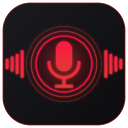

# Vocalis

An offline voice AI workstation: dictation, a quick-reader for anything
you've copied, a document reader (with pause/resume), and an OCR reader
that speaks text straight off your screen. Once installed, it runs on
your own machine — no cloud service and no account. The installer
downloads the voice models, the Piper speech program, `uv`, and a few
system packages once; the app itself makes no network calls.

## Installing

1. Download `install.run` from the
   [latest release](https://github.com/reduxailabs-max/vocalis/releases/latest)
   (and `SHA256SUMS.txt` if you want to check the download).
2. Make it runnable and start it:
   `chmod +x install.run && ./install.run`
3. A setup window guides you through the rest: it downloads the voices,
   lets you test your microphone, and starts Vocalis.

Works on Debian/Ubuntu-family Linux. A graphics card from NVIDIA makes
dictation faster but is not required. The extra **Qwen3-TTS** voice is
optional (it needs a strong NVIDIA card and about 8 GB more); you can add
or remove it later in Settings. To remove Vocalis, run `uninstall.run`.

More detail, including terminal-only installs, is in
[`packaging/installer/README.md`](packaging/installer/README.md).

## Using it

The full guide to every feature, the tray icon, the floating widget, and
Settings lives in [`docs/user-docs.md`](docs/user-docs.md).

## Contributing / developing

Setup, running the test suite, and project conventions are in
[`docs/developer-docs.md`](docs/developer-docs.md). The design is in
[`docs/architecture.md`](docs/architecture.md), and the folder layout is in
[`docs/folder-structure.md`](docs/folder-structure.md).

## License

Vocalis is released under the [MIT License](LICENSE). The voice and speech
models it downloads come with their own licenses (Qwen3-TTS and Parakeet are
Apache-2.0 or similar; see each model's page).
